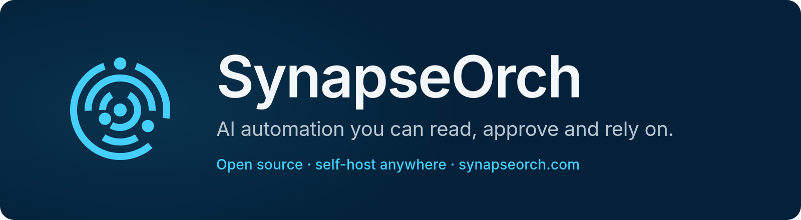
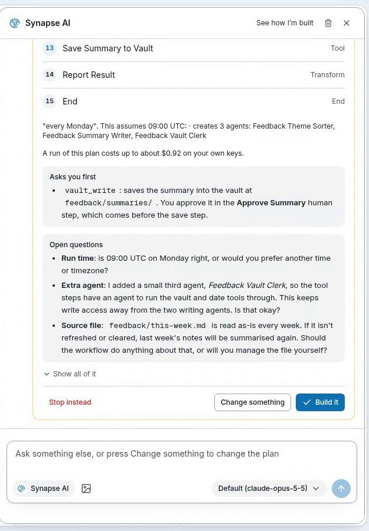
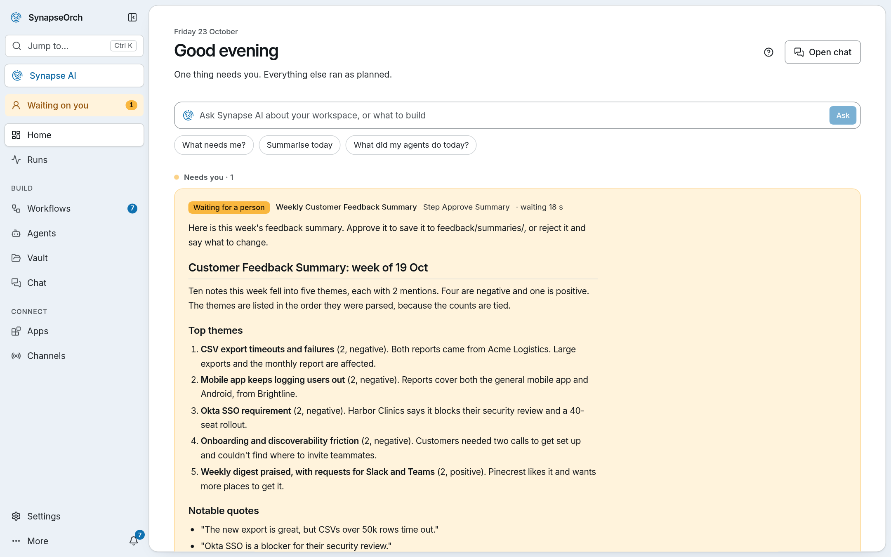
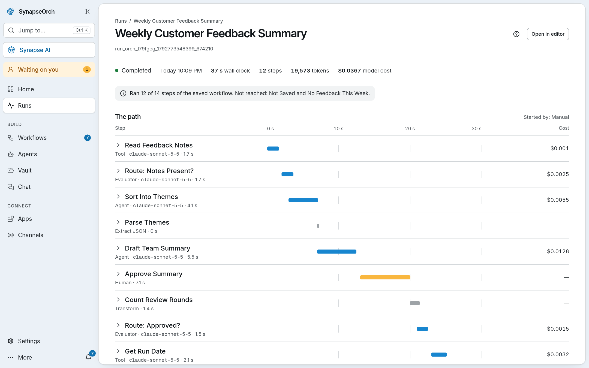

<p align="center">
  <a href="https://synapseorch.com">
    
  </a>
</p>

<p align="center">
  <a href="LICENSE"></a>
  <a href="https://pypi.org/project/synapse-orch-ai/"></a>
  <a href="https://discord.gg/9UN45qyGh8"></a>
</p>

**SynapseOrch builds and runs AI workflows that take a fixed path.** Describe a job in plain words and it shows you a
plan: the steps, the model for each, what a run should cost, and where a person signs off. Nothing is built until you
approve it, and every run then follows that path. Models do the work inside the steps; they don't decide which step
comes next.

**It's for** developers and automation builders, working for their own team or for clients, who need an AI workflow
to behave the same on its fiftieth run as on its first. Self-hosted, any model, AGPL-3.0: no account, no licence
check, no telemetry.

## Install

```bash
curl -LsSf https://synapseorch.com/install.sh | bash     # macOS, Linux
```

```powershell
irm https://synapseorch.com/install.ps1 | iex            # Windows (PowerShell)
```

It brings its own Python (and Node.js, if yours is missing or older than 20.9), needs no sudo, keeps everything in
`~/.synapse`, and ends with a link to open. [pip, npm and Docker ↓](#more-ways-to-install)

## Your first workflow, without an account

1. **Choose a model when the installer asks "Which AI should Synapse use?"** Synapse AI, the assistant that builds
   workflows from a description, needs a capable model: paste a key for Anthropic, OpenAI, Gemini, Groq, OpenRouter,
   DeepSeek, Mistral or another provider. No key yet? A free Gemini key from
   [Google AI Studio](https://aistudio.google.com/apikey) takes a few minutes (your prompts go to Google).
2. **Open the link it prints.** Synapse AI's chat opens. Describe a job, for example: *"Every weekday at 9, read the
   Hacker News front page, pick the three stories about AI agents, summarise each in two lines, and ask me before
   saving the summary to the vault."*
3. **Read the plan, approve it, then run the workflow.** The run stops at your sign-off: answer it under **Needs
   you** on Home, or from the terminal with `synapse runs answer`.

**Only local models?** The installer finds [Ollama](https://ollama.com/download) and its models, and workflow steps
run well on them, with your prompts staying on your machine. Building with Synapse AI on a small local model doesn't
work well yet, so draw the workflow in the editor, or give Synapse AI a hosted model in Settings → Models and keep
the steps local. [Models and providers →](https://docs.synapseorch.com/llm-providers/overview)

<!-- DEMO VIDEO: a shorter MP4 can replace the GIF: drag demo.mp4 into a GitHub comment box, and paste the user-attachments link it gives on its own line here, so it plays inline. -->

<p align="center">
  
  <br />
  <sub>A real session on a hosted Claude model, the model’s waits sped up: one sentence to a built workflow, then a run that waits for a sign-off.</sub>
</p>

<p align="center">
  <a href="https://docs.synapseorch.com"><strong>Documentation</strong></a> ·
  <a href="#how-it-compares"><strong>How it compares</strong></a> ·
  <a href="https://discord.gg/9UN45qyGh8"><strong>Discord</strong></a> ·
  <a href="https://synapseorch.com/cloud"><strong>SynapseOrch Cloud</strong></a>
</p>

---

## Describe it. Approve it. Rely on it.

- **Describe it.** Tell **Synapse AI** the job. It writes the steps, picks a model for each and marks where you sign
  off, then shows you the plan before anything is built.
- **Approve it.** Read every step. When a run reaches yours, it waits for your yes — in the app, or in Slack,
  Telegram or another chat channel.
- **Rely on it.** It runs on schedule exactly as you approved, and shows what each step did and what it cost. A run
  stops once it reaches the spending limit you set.

<table>
<tr>
<td width="38%" valign="top"><br /><sub><b>Describe it.</b> Synapse AI shows the plan, what a run costs and what it will ask you — before it builds anything.</sub></td>
<td width="62%" valign="top"><picture>
  <source media="(prefers-color-scheme: dark)" srcset="https://raw.githubusercontent.com/synapseorch-ai/synapse-ai/master/.github/assets/readme/home-dark.png" />
  
</picture><br /><sub><b>Approve it.</b> When a run reaches your step, it waits on Home for your yes.</sub></td>
</tr>
</table>

<picture>
  <source media="(prefers-color-scheme: dark)" srcset="https://raw.githubusercontent.com/synapseorch-ai/synapse-ai/master/.github/assets/readme/result-dark.png" />
  
</picture>
<p align="center"><sub><b>Rely on it.</b> Every run shows the path it took, how long it waited on you, and what each step cost.</sub></p>

## What's inside

| | |
|---|---|
| **Synapse AI** | An assistant that builds and changes agents and workflows from a sentence, and answers questions about your workspace. |
| **Workflows** | Steps you can read on a canvas: agents, models, tools, code, branches, loops, parallel paths, sign-offs and other workflows. Runs follow the path you drew. |
| **Agents and teams** | Agents with their own model, tools, skills and memory. A team agent splits work among its members; any agent can start short-lived helpers. |
| **Sign-offs** | A step that waits for a person — answered in the app or in a chat channel. Approvals for risky tool calls, too. |
| **Knowledge** | Your files and web pages, indexed; answers cite the passage they used. *(Optional part — see below.)* |
| **Boards** | A shared to-do board for people and agents, with each card's history. *(Off until you turn it on in Settings.)* |
| **Apps and tools** | MCP servers (local or remote, OAuth included), REST and OpenAPI, Python functions, SQL databases, web fetch and scraping. |
| **Channels** | Your agents on Slack, Discord, Telegram, Microsoft Teams, WhatsApp, a website chat widget, or a phone number (Twilio). |
| **Any model** | Your own keys for 23+ providers, any OpenAI-compatible endpoint, local models through Ollama, or the Claude Code, Codex, Gemini and Copilot CLIs you already use. A different model at every step. |
| **Costs you can read** | An estimate before a run, what each step cost after it, and a spending cap per run, checked before each step. |
| **Use it from anywhere** | A command line, a versioned REST API, an MCP server for Claude, ChatGPT and Cursor, and an OpenAI-compatible endpoint where every agent answers as a model. |
| **Scale mode** | Redis queue, a worker fleet, Postgres checkpoints and S3 storage, for when one process is not enough. |

## How it compares

| | What it is | You build it by | Licence |
|---|---|---|---|
| **SynapseOrch** | An app that builds and runs AI workflows, with a UI, REST API, CLI and MCP server | Describing it (Synapse AI drafts a plan you approve) or drawing it | AGPL-3.0 |
| n8n | A workflow automation app with 500+ integrations | Drawing it, code nodes, or its Assistant (in preview) | Sustainable Use License (source-available) |
| Dify | An LLM app platform with a visual workflow canvas | Drawing it | Apache 2.0 with added conditions |
| LangGraph | A library for agent graphs in Python and JavaScript | Writing code | MIT |
| CrewAI | A Python framework for teams of agents | Writing code | MIT |
| Temporal | A durable-execution engine for workflows written in code | Writing code | MIT |

If you need hundreds of ready integrations, n8n has far more than we do. If an engineer will own the agent in code,
a library is the better fit, and your code can still start SynapseOrch runs through the API. Where each one is the
better choice: [synapseorch.com/compare](https://synapseorch.com/compare/).

---

## More ways to install

The one-line installer above asks which AI to use (and whether to start on login) while it installs; add `--yes`
(`curl … | bash -s -- --yes`) to take every default. The short addresses redirect to the scripts on the latest GitHub
release: [setup.sh](https://github.com/synapseorch-ai/synapse-ai/releases/latest/download/setup.sh) and
[setup.ps1](https://github.com/synapseorch-ai/synapse-ai/releases/latest/download/setup.ps1).

**npm, pip or Docker**

```bash
npm install -g synapse-orch-ai && synapse      # the first run uses the same installer
pip install synapse-orch-ai && synapse         # Python 3.11–3.14 and Node.js 20.9+
```

```bash
docker run -d --name synapse -p 3000:3000 -p 127.0.0.1:8765:8765 \
  -v synapse-data:/data \
  -v /var/run/docker.sock:/var/run/docker.sock \
  synapseorchai/synapse-ai:latest
```

Then open `http://localhost:3000`. The backend's port (`8765`) is published on this machine only: it serves an
internal API, so never publish it on `0.0.0.0`.

**Optional parts.** Knowledge brings Docling and a CPU build of PyTorch, so it is added only when you ask:

```bash
synapse upgrade --with knowledge                              # an existing install
curl -LsSf …/setup.sh | bash -s -- --with knowledge           # a new one
```

Then turn it on in Settings → General. Every later upgrade keeps it.

## Upgrading

```bash
synapse upgrade
```

It backs up the database, installs the newest version, updates the database and starts Synapse again if it was running.
An npm install is upgraded with `npm install -g synapse-orch-ai@latest`; Docker by pulling the new image and running
the same command.

**Coming from 1.x?** Run the install command above, or `synapse upgrade`. Your agents, workflows, chats, schedules,
settings, API keys and vault files move into 2.0's store. Before anything changes, the upgrade backs up your 1.x data
folder, logs and `.env` to `~/.synapse/backups/synapse-1.x-<date>.tar.gz`, with a `manifest.json` that lists where each
part came from; the old install's folder is removed once 2.0 is running. To go back, reinstall 1.9.3 and put each part
of the backup back where `manifest.json` says. Don't run 2.0's `synapse uninstall` first: it removes `~/.synapse`,
backups included, unless you add `--keep-data`. Docker imports a 1.x `/data` volume on its first start. See
[Upgrading to 2.0](https://docs.synapseorch.com/getting-started/upgrading-to-2).

---

## The command line

One `synapse` command runs SynapseOrch on this machine, and drives any SynapseOrch — this one, one on your servers, or
Cloud — with an API key. Everything you can do in the app, you can do from a terminal or a script.

**This machine**
```bash
synapse start                        # open it (-d: in the background)
synapse status                       # is it running? (--json for scripts)
synapse logs -f                      # follow the backend's log (frontend, install)
synapse upgrade                      # the newest version; data and settings stay
synapse autostart on                 # start when you log in
```

**Build, run and answer**
```bash
synapse agents list                  # list, show, create, update, delete
synapse workflows list               # list, show, export, create, validate, deploy, delete
synapse run NAME -m "…"              # run a workflow and follow it to its answer
synapse runs waiting                 # what waits on you: questions and held tool calls
synapse runs answer RUN_ID --approve # answer a sign-off (or --reject, or reply with text)
synapse chat --agent NAME -m "…"     # one message to an agent (bare `synapse chat` to talk)
synapse schedules create --workflow NAME --cron "0 9 * * MON"
```

**Knowledge, Boards and the workspace**
```bash
synapse knowledge upload --base Handbook ./policies/*.pdf --wait
synapse knowledge search "refund window" --base Handbook
synapse boards show BOARD            # a board's open cards; `boards card` adds and comments
synapse activity --days 7            # what ran, what failed, what waits
synapse usage --by model             # what the workspace spent, by day, agent or model
```

**Every door a key has**
```bash
synapse tools list                   # every product tool this key may call; `tools call NAME`
synapse api GET /agents              # call any route a key reaches, as `gh api` does
synapse mcp                          # serve SynapseOrch to Claude, Cursor… over stdio
synapse login --url https://api.synapseorch.com --api-key-stdin   # drive another SynapseOrch
```

For scripts, `--json` prints JSON (one event a line for a run) and `-q` lists ids only. Exit codes say what happened:
`0` done · `3` waiting on a person · `4` run failed · `5` not found · `6` key refused · `7` busy or unreachable.
`synapse --help` lists every command. [CLI reference →](https://docs.synapseorch.com/cli/commands)

## Use it from your own code and tools

- **REST API** — start runs, stream their events, answer sign-offs, with an API key.
  [API →](https://docs.synapseorch.com/api/overview)
- **MCP server** — build and run workflows from Claude, ChatGPT or Cursor.
  [MCP server →](https://docs.synapseorch.com/api/mcp-server)
- **OpenAI-compatible endpoint** — every agent answers as a model to any OpenAI client, with its own tools.

## Scale mode

When one process is not enough: a Redis job queue, 1 to 100+ workers, per-step Postgres checkpoints (a worker that dies
loses nothing), S3-compatible storage and per-team run limits — behind the same API.

```bash
docker pull synapseorchai/synapse-ai-api-server:latest   # stateless API server
docker pull synapseorchai/synapse-ai-worker:latest       # workers, as many as needed
```

`docker compose --profile scale up` runs the whole stack (with `REDIS_URL` set in `.env`); Kubernetes examples are in
`infra/k8s/`.
[Scale mode →](https://docs.synapseorch.com/scale/overview)

## Running it on a network

Everything an agent can do runs on the machine Synapse runs on, so treat a shared instance like a server:

- turn on **login** (Settings → General) on anything reachable beyond your own machine;
- publish only the web port (`3000`) on the network, never the backend's (`8765`);
- local MCP servers and custom Python tools run commands: turn them off with `allow_stdio_mcp` if you do not trust
  every user, and give agents the narrowest tools that do the job.

Security issues: please report them privately — see [SECURITY.md](SECURITY.md).

---

## SynapseOrch Cloud

The same product, run for you: no servers, managed models, plans with a hard monthly limit, and teams with roles.
[synapseorch.com](https://synapseorch.com)

## Contributing

See [CONTRIBUTING.md](CONTRIBUTING.md) for the development setup, how the pieces fit, and the PR checklist.
Questions and ideas are welcome on [Discord](https://discord.gg/9UN45qyGh8).

## License

SynapseOrch is licensed under the [GNU AGPL v3](LICENSE).

[](https://www.star-history.com/#synapseorch-ai/synapse-ai&type=date&legend=top-left)
